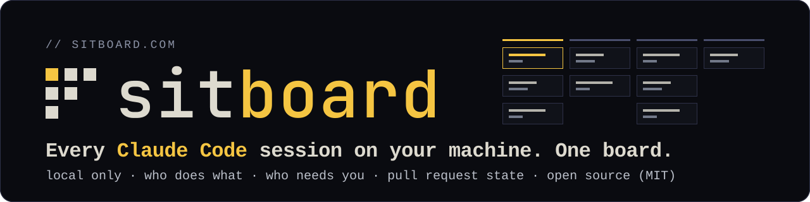

<p align="center">
  <a href="https://sitboard.com"></a>
</p>

<p align="center">
  <a href="https://github.com/IZZY-Agency/sitboard/actions/workflows/ci.yml"></a>
  <a href="https://github.com/IZZY-Agency/sitboard/releases/latest"></a>
  <a href="https://github.com/IZZY-Agency/homebrew-tap"></a>
  <a href="LICENSE"></a>
</p>

# sitboard

A live board of the Claude Code sessions running on your machine.

sitboard is a small command-line tool: it starts a web server on your machine
and opens the board in your browser. It answers two questions at a glance:
**who does what**, and **who needs me**. It finds the running sessions by
itself: nobody creates tasks in it, and the agents need no setup. When it
cannot tell something, it says "unknown" instead of guessing.

[Website](https://sitboard.com) ·
[Releases](https://github.com/IZZY-Agency/sitboard/releases) ·
[Issues](https://github.com/IZZY-Agency/sitboard/issues)


*Sample data.*

## What it does

- **A card per session.** Each card shows the session's name or title, its
  project, status and model (a Claude model in its family's colour: Fable,
  Opus, Sonnet, Haiku) with its effort level (low to max; before the first
  reply, the level it was started with, marked "at launch"), how long it has
  been in that state, the pull requests it opened with their checks and
  review, and, on the Board, links to those pull requests, to the issues they
  close and to the claude.ai artifacts it published.
- **A critter for every agent.** Each agent gets its own small creature,
  drawn from its session id, which helps tell agents apart; its eyes, outline
  and the line under its feet show the state, and the column and words still
  say it. Critters move only while you can see them, and with reduced motion
  they stay still.
- **Board** (the default view). One column per state, in this order: Needs
  you, Working, With coordinator, In review, Done · 24h, Idle.
- **Lanes.** One row per project, with a "Needs you" strip on top.
- **Teams.** Your queue beside one panel per coordinator with its workers, and
  one panel of solo agents.
- **Project tiles or a side rail.** You choose which; they pick the projects
  every view shows. A project that spans several repositories shows as one
  entry with its parts. A grouping you do not want can be forgotten once
  (that folder stays apart until no agent has sat in it for two minutes) or
  set to never group; a grouping you want to keep can be set to always group.
  The status bar lists every folder with a setting, to set it back to auto.
- **Catch-up.** A panel with the finished turns, pull requests opened and
  merged, and artifacts published since you last pressed "Caught up", up to
  7 days back, grouped by project. Opening it marks nothing read. It covers
  the Claude Code sessions that ran in the last 7 days, including those that
  had ended before sitboard started; while those are still being read, the
  panel says so.
- **A tap on the shoulder.** The tab's title and icon show how many agents
  need you, and the icon a "?" when the board is not live. Turn on Notify in
  the header for a desktop notification when an agent starts needing you; for
  one agent it says why, for several how many, never which agent or task, and
  it stays quiet while the board is in front of you. The switch is off until
  you turn it on, and the choice holds for every tab of that board's address
  in that browser (sitboard on another port asks again).
- **A jump to the terminal.** With [agterm](https://github.com/umputun/agterm),
  one click jumps to the session's terminal, and cards get better titles;
  without it, clicking a card shows the session's folder and name to copy.

## Privacy

- **Local only.** sitboard listens on `127.0.0.1`, never on your network.
- **A private link.** It prints a link that carries a secret for this run; your browser swaps it for a cookie. Requests without it, and requests from other websites, are refused.
- **Nothing leaves your machine**, except read-only GitHub lookups for pull request state, made through your own `gh` command. sitboard never reads or stores a GitHub token. With `--no-github` there is no network traffic at all.
- **What it reads.** Claude Code's session files, and the transcripts of the sessions that ran in the last 7 days, not only running ones, to derive states, times, models, effort levels, pull requests, artifacts and names. It keeps only those derived facts, in memory. When it first sees a session in a running `claude` process, it reads the process's arguments and environment (on macOS through the kernel's `kern.procargs2` query, on Linux from `/proc/<pid>/cmdline` and `/proc/<pid>/environ`) and keeps two facts: the agterm session id from `AGTERM_SESSION_ID`, and the effort level the session was started with, from the `--effort` flag or `CLAUDE_CODE_EFFORT_LEVEL`, as one of the five level words. Every other argument and variable is read past and not kept, logged or served. It also asks `git` about each session's folder (repository, branch and remote), `ps` for when the `claude` processes started, and, with agterm, `agtermctl` for its windows, workspaces and sessions.
- **What it writes.** Only its own state file and, beside it, that file's lock file (creating their folder if needed). The state file (`~/Library/Application Support/sitboard/state.json` on macOS; on Linux `$XDG_STATE_HOME/sitboard/state.json`, by default `~/.local/state/sitboard/state.json`; or the file given with `--state`) keeps which cards you have seen, the catch-up marker, the folders that group projects, the groupings you forgot, the folders you set to always or never group, and, for catch-up items still unread behind the marker, a hash of each item's identity (not the identity itself) and its time. The lock file holds only the running board's process number and machine name, and a clean stop empties it. With `--no-state` it writes neither.
- **No prompts, code or tool output.** The page gets session names and titles, home-relative folder paths (including the folders you set to always or never group, up to 200, whether or not an agent works in them), repository names with their owner ("owner/name"), agterm workspace names, pull request numbers, titles and github.com links with their state, checks, review and draft flag, the numbers and github.com links of the issues they close in the pull request's own repository, and the links and titles of the artifacts a session published, plus derived fields such as states, times, model ids and effort levels, subagent counts, the versions of the tools it reads, and sitboard's own version, commit, operating system and architecture. A session's name is the one Claude Code records for it or, when it has none, its agterm terminal's name. A session's title is its open pull request's title or, with agterm, the short title Claude Code puts on its terminal, which is Claude Code's own summary of the task; without either, it is the session's name, its terminal's name or its folder's name. Prompt text, code and tool output are never shown and never served. The only free text the page gets from a transcript is an artifact's title (the title its own publish reported) and, when the session's own record has no name (as for a session that has ended), the name Claude Code recorded for it in the transcript (yours, or one it made itself, for example from a plan), both cleaned and shortened.
- **Desktop notifications** are off until you turn them on. The browser shows them from the page, on this machine, and they never name an agent, a project or a task. The switch, and which notifications were already shown, are kept in that browser's storage for the board's address.
- **No telemetry**, no update check, no crash reports.

## Install

```sh
brew install izzy-agency/tap/sitboard
```

The formula lives in [IZZY-Agency/homebrew-tap](https://github.com/IZZY-Agency/homebrew-tap)
and installs the archive of the
[latest release](https://github.com/IZZY-Agency/sitboard/releases/latest) for
your machine; `brew upgrade` keeps it current. You can also download that
archive yourself and put `sitboard` on your `PATH`.

The macOS builds, for Apple silicon and Intel, are signed with a Developer ID
and notarized. Tested on macOS. Linux builds are provided but not tested by us
yet.

## Run

```sh
sitboard
```

It prints its private link for this run and opens the board in your browser.

Flags: `--port`, `--no-open`, `--no-github`, `--roots` (only agents working under these folders), `--stale-after` (default `20m`), `--state <file>` (use this state file instead of the default one), `--no-state` (keep seen marks, the catch-up marker and groupings in memory only), `--version`, `--licenses` (sitboard's licence and the third-party notices).

One state file has one board: while sitboard runs, a second sitboard (0.3.0 or later) on the same state file refuses to start. Give a second board its own file with `--state <file>`, or use `--no-state` for a throwaway run that saves nothing. The lock is a `<state file>.lock` file beside the state file, which holds the running board's process number and machine name; a clean stop empties it. On a folder that does not support locks, sitboard warns and runs without the lock.

## Requirements

- [Claude Code](https://claude.com/claude-code): sitboard shows its sessions.
- Optional: [`gh`](https://cli.github.com), logged in, for pull request state.
- Optional: [agterm](https://github.com/umputun/agterm), for the one-click jump to a session's terminal and better card titles.

## Not there yet

- Codex sessions: only Claude Code sessions are shown.
- Leftovers: merged work whose worktree, branch or session still exists.

See [CHANGELOG.md](CHANGELOG.md).

## Build from source

You need Go 1.27 and Node 22.

```sh
git clone https://github.com/IZZY-Agency/sitboard.git
cd sitboard
make build        # builds the web page, then bin/sitboard with the page embedded
```

For development:

```sh
make check PRIVATE_FLAGS=--no-denylist   # lint, tests, web checks, contract freshness, release-script tests, private-material guard
make contract                            # regenerate web/src/contract.gen.ts from internal/contract
```

`scripts/check-private.sh` keeps private material out of the repository: home paths, tokens, email addresses and hidden characters. Maintainers also run it with a private deny-list of names (see `scripts/make-denylist.sh`); `--no-denylist` runs the generic rules only.

Releases are made by the maintainers, with the scripts described in [scripts/README.md](scripts/README.md).

## How this repository is maintained

sitboard is developed in a private repository. Each release is published here
as a single commit tagged with its version, so a release tag always points at
the tree its build came from. Small updates between releases (this README, CI,
tooling) arrive as commits without a tag. Bug reports and feature requests go
in [Issues](https://github.com/IZZY-Agency/sitboard/issues).

## Licence

[MIT](LICENSE). The third-party components sitboard ships with, and their licences, are listed in [THIRD_PARTY_NOTICES.md](THIRD_PARTY_NOTICES.md); `sitboard --licenses` prints them too.
